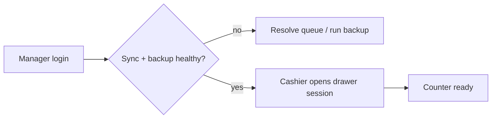
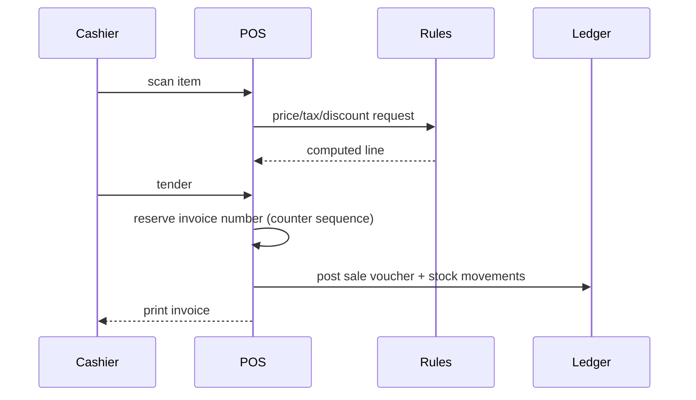
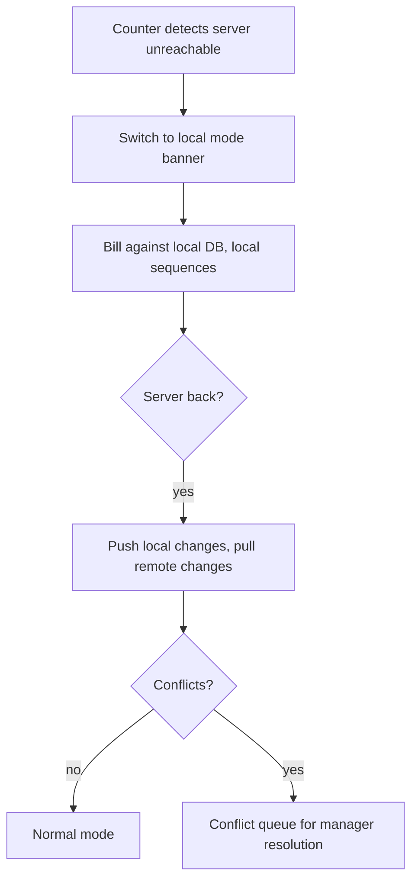

# Business processes (as-is / to-be)

## BP-1 Daily store open

1. Manager logs in, reviews overnight sync status and backup result.
2. Each cashier opens a drawer session with a counted float.
3. Price/promotion rules effective today are activated automatically by validity window.

## BP-2 Sale at the counter

1. Scan or search items; rules compute price, tax and eligible discount.
2. Discount beyond the cashier's limit raises an approval request to a manager (in-store, on any node, or PIN override at the counter).
3. Tender is collected, possibly split; change computed; loyalty accrued.
4. Invoice posted: stock movements created, GL postings generated by posting rules, invoice printed, optional SMS/email queued.

## BP-3 Sales return / exchange

Look up original invoice → select lines and quantities → restock (or scrap) with batch identity preserved → issue credit note → refund via original tender or store credit → reversal postings.

## BP-4 Purchase to payment

Purchase order → goods receipt (batch, expiry, cost capture) → supplier invoice match within tolerance → payables posting → payment (cash/bank/UPI) → supplier ledger settlement. Landed costs apportioned at receipt or at invoice, configurable.

## BP-5 Stock-take

Freeze counting scope (category/location) → generate blind count sheets or handheld session → enter counts → system computes variance → manager approves → adjustment movements and GL posting to shrinkage/gain account → audit entry.

## BP-6 Processing / assembly (hardware, paint, food processing)

Create production order referencing a BOM → issue components (FEFO) → record output batch with computed cost (component cost + configured overhead) → optional by-product/scrap → GL postings to WIP and finished goods.

## BP-7 Day close

Cashier closes drawer with counted denominations → variance recorded → manager approves → day-close summary (sales, tenders, discounts, voids, returns) generated, printed and optionally emailed/SMSed → backup triggered → sync flush attempted.

## BP-8 Period close

Accountant reviews unposted items → posts adjustments → locks period → statements generated → tax return export produced. Locked periods reject new postings; corrections require a reversal in an open period.

## BP-9 Offline degradation and recovery

## BP-10 Support and monitoring (multi-store)

Owner/support views node health (last sync, version, disk, backup age, error count), pulls a diagnostic bundle, and pushes configuration or rule updates that nodes apply on next sync.
