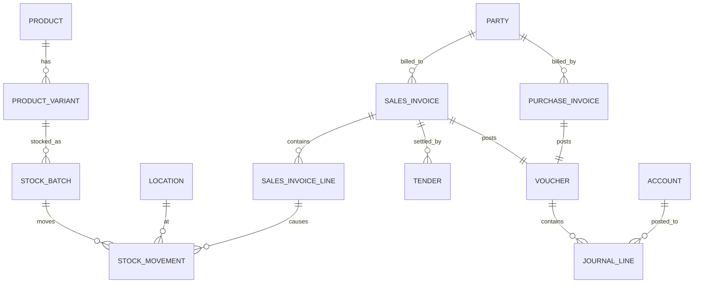

# Data architecture

## 1. Principles

1. **Movements, not mutable balances.** Stock on hand and account balances are derived from immutable movement/journal rows; cached aggregates exist only as rebuildable projections (NFR-023).
2. **Sync-ready by construction.** Every business table carries `id UUID (v7)`, `node_id`, `version`, `updated_at`, `updated_by`, `deleted`.
3. **Soft delete only** for business data (CMP-05).
4. **Tenant and store scoping** on every row that can differ per store (`tenant_id`, `store_id`), indexed leading in multi-store deployments.
5. **JSONB for extensibility**: plugin and layout-driven extra attributes live in `attributes jsonb` with a per-entity JSON schema registered by the plugin, avoiding schema churn.

## 2. Schema domains



Domains:

- **Masters**: `tenant`, `store`, `location`, `counter`, `product`, `product_variant`, `uom`, `uom_conversion`, `category`, `brand`, `tax_class`, `price_list`, `price_list_line`, `party` (customer/supplier), `party_group`, `account` (chart of accounts), `user`, `role`, `permission`.
- **Inventory**: `stock_batch`, `stock_movement`, `stock_snapshot` (projection), `stock_take`, `stock_take_line`, `transfer`, `transfer_line`, `bom`, `bom_line`, `production_order`, `production_line`.
- **Sales**: `pos_session`, `drawer_session`, `cart` (transient, local only), `sales_invoice`, `sales_invoice_line`, `tender`, `sales_return`, `credit_note`, `loyalty_account`, `loyalty_txn`.
- **Purchasing**: `purchase_order`, `goods_receipt`, `purchase_invoice`, `landed_cost`, `debit_note`, `payment`.
- **Accounting**: `voucher`, `journal_line`, `period`, `posting_rule`, `tax_ledger_entry`, `year_close_snapshot`.
- **Platform**: `rule_package`, `rule_version`, `layout`, `layout_version`, `report_template`, `notification_template`, `notification_outbox`, `setting`, `plugin_registration`, `audit_event`, `change_log`, `sync_state`, `conflict`.

## 3. Key table sketches

```sql
create table stock_movement (
  id            uuid primary key,          -- UUIDv7
  tenant_id     uuid not null,
  store_id      uuid not null,
  node_id       uuid not null,
  variant_id    uuid not null references product_variant,
  batch_id      uuid references stock_batch,
  location_id   uuid not null references location,
  qty           numeric(18,3) not null,    -- signed: + in, - out
  uom_id        uuid not null,
  unit_cost     numeric(18,4),             -- valuation cost at movement time
  reason        text not null,             -- SALE, PURCHASE, ADJUST, TRANSFER, PRODUCE, CONSUME, RETURN, WRITE_OFF
  doc_type      text not null,
  doc_id        uuid not null,
  doc_line_id   uuid,
  business_date date not null,
  occurred_at   timestamptz not null,
  created_at    timestamptz not null default now(),
  updated_at    timestamptz not null default now(),
  updated_by    uuid not null,
  version       bigint not null default 0,
  deleted       boolean not null default false
);
create index on stock_movement (tenant_id, store_id, variant_id, business_date);
create index on stock_movement (doc_type, doc_id);
```

```sql
create table journal_line (
  id          uuid primary key,
  voucher_id  uuid not null references voucher,
  account_id  uuid not null references account,
  debit       numeric(18,4) not null default 0,
  credit      numeric(18,4) not null default 0,
  cost_centre_id uuid,
  narration   text,
  check (debit >= 0 and credit >= 0 and (debit = 0 or credit = 0))
);
-- Voucher-level constraint: sum(debit) = sum(credit), enforced in domain + a deferred trigger.
```

```sql
create table change_log (
  change_id   uuid primary key,            -- idempotency key for sync
  node_id     uuid not null,
  seq         bigserial not null,          -- per-node monotonic
  entity      text not null,
  entity_id   uuid not null,
  op          text not null,               -- INSERT/UPDATE/SOFT_DELETE
  payload     jsonb not null,              -- full row snapshot after change
  base_version bigint,                     -- version the change was based on
  created_at  timestamptz not null default now(),
  synced_at   timestamptz
);
create unique index on change_log (node_id, seq);
```

## 4. Valuation

- Default method: **weighted average per variant per store**, recomputed from movements; **FIFO/FEFO by batch** for batch-tracked items; method is a tenant setting and cannot be changed mid-period.
- `stock_snapshot` holds a daily materialised on-hand and value per variant/batch/location, used by reports and rebuilt nightly plus incrementally.
- Cost corrections (late landed cost, purchase price amendment) create an explicit revaluation movement and GL posting rather than editing history.

## 5. Projections and reporting data

| Projection | Source | Refresh |
| --- | --- | --- |
| `stock_snapshot` | `stock_movement` | Incremental on commit + nightly full rebuild |
| `account_balance_period` | `journal_line` | Incremental + month-end rebuild |
| `sales_daily_agg` | invoices/lines | Nightly and on-demand |
| `customer_outstanding` | invoices, receipts | Incremental |

Analytics queries hit projections, never the transactional tables, to keep POS latency (NFR-001/2) intact. On a store server, reporting can additionally run against a read replica.

## 6. Encryption at rest

| Data | Mechanism |
| --- | --- |
| Customer/supplier PII, bank details, credit terms | Column-level AES-256-GCM via Hibernate `AttributeConverter`; per-tenant data key |
| User password | Argon2id hash (not encryption) |
| Tokens/secrets (gateway API keys) | Encrypted with node key in `setting` table, never logged |
| Backups | Encrypted archive with a separate backup key |
| Whole database (optional) | OS-level disk encryption recommended in install guide |

Key hierarchy: master key in OS keystore (Windows DPAPI / Linux libsecret or a permissions-restricted key file) → tenant data key (wrapped, stored in DB) → per-column AEAD with entity id as associated data. Key rotation re-wraps tenant keys without re-encrypting all rows; column re-encryption is a background job.

Encrypted columns cannot be searched directly; searchable fields (customer phone) additionally store a blinded HMAC index (`phone_hmac`) for exact-match lookup.

## 7. Retention and archival

- Transactional data stays online for the current + 2 previous financial years; older years move to an archive schema queryable read-only, and to archive backups (CMP-04).
- Audit events never purged within the retention window; archived with hash-chain continuity markers.
- `change_log` rows are pruned once acknowledged by all known peers and older than 30 days.

## 8. Multi-database support

PostgreSQL is the reference. MySQL 8 is supported through a compatibility subset: no `jsonb` (uses `json` + generated columns for indexed paths), no partial indexes (replaced by filtered projections), no deferred constraints (voucher balance enforced in domain + application-level check). Migrations are maintained per-dialect in Flyway with a shared logical changelog and a conformance test suite running both engines.
