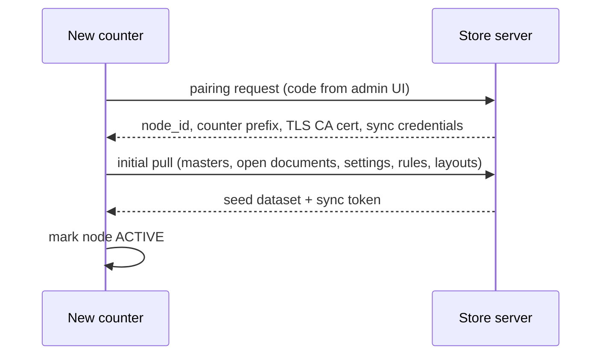

# Deployment architecture

## 1. Node roles

| Role | Processes | Database | Network needs |
| --- | --- | --- | --- |
| STANDALONE | JavaFX client with embedded app context | Local PostgreSQL | None |
| COUNTER | JavaFX client with embedded app context + sync agent | Local PostgreSQL | LAN to store server (optional) |
| THIN_CLIENT | JavaFX or browser UI only | None | LAN required |
| STORE_SERVER | Spring Boot (REST + Vaadin + Quartz) | Store PostgreSQL | LAN; internet optional |
| CLOUD | Spring Boot multi-tenant + object storage | Cloud PostgreSQL | Internet |

## 2. Reference hardware

| Role | CPU | RAM | Disk |
| --- | --- | --- | --- |
| Counter | 2 cores | 4 GB | 64 GB SSD |
| Store server | 4 cores | 8 GB | 256 GB SSD (RAID-1 recommended) |
| Cloud (per 50 stores) | 4 vCPU | 16 GB | 500 GB + object storage |

## 3. Installation

- Single installer per OS produced by `jpackage` with a jlink'd runtime (no system JRE requirement).
- PostgreSQL bundled as a silent-installed service on Windows; native package dependency on Linux.
- First-run wizard: tenant/store identity, node role, admin user, chart-of-accounts template, tax profile, printer setup, backup location, optional server address and pairing code.
- Unattended mode via `install.properties` for implementers (P6, NFR-021).

## 4. Node provisioning and pairing

Counter prefixes and document series ranges are allocated at pairing, guaranteeing offline uniqueness (ADR-006).

## 5. Network and ports

| Flow | Port | Protocol | Notes |
| --- | --- | --- | --- |
| Client → store server API | 8443 | HTTPS | TLS with store CA |
| Browser → Vaadin | 8443 | HTTPS | Same app |
| Store server → cloud | 443 | HTTPS | Outbound only; no inbound to store |
| Local admin/health | 9090 | HTTP on loopback | Metrics, health, log bundle |
| PostgreSQL | 5432 | TCP, loopback or LAN-restricted | Never exposed to WAN |

Store LAN is expected to be a flat network; the installer configures the host firewall to restrict PostgreSQL to loopback (counter) or to the store subnet (server).

## 6. Certificates

- Store server generates a store CA at first run; the CA certificate is distributed during pairing and installed into each client's truststore.
- Cloud endpoints use public CA certificates; the store agent pins the cloud certificate's public key.
- Certificate rotation is a supported admin operation with a grace period during which both CAs are trusted.

## 7. Backups

| Tier | What | When | Where | Retention |
| --- | --- | --- | --- | --- |
| T1 local | `pg_dump` custom format + config + rule/layout snapshot | Hourly incremental WAL, nightly full | Second local disk / USB | 14 dailies, 8 weeklies |
| T2 off-site | Encrypted (age/AES-256-GCM) copy of T1 | Nightly if connected | Cloud object storage | 90 days |
| T3 archive | Year-close snapshot with hash | Annually | Cloud + owner's media | 8 years (CMP-04) |

Backups are verified by restoring into a scratch database and running a balance self-check weekly (NFR-009, RSK-7). Backup health is surfaced on the owner dashboard and blocks nothing but raises an alert after 2 failed cycles.

## 8. Upgrades

1. Artifacts distributed via installer, LAN share, or cloud push (owner-approved).
2. Store server upgrades first; clients detect version skew and prompt.
3. API compatibility window: server supports clients N-2 minor versions.
4. Flyway migrations are forward-only and must tolerate a node that has been offline for months (NFR-022); sync refuses to run until both sides are at compatible schema versions, degrading to local-only operation rather than corrupting data.
5. Rollback strategy: restore T1 backup + previous installer; migrations that are not safely reversible must be announced in release notes and preceded by an automatic pre-upgrade backup.

## 9. Monitoring

Each node exposes health locally and, when connected, pushes to cloud monitoring: version, uptime, last successful sync, pending change count, conflict count, backup age/result, disk free, error-rate, printer status. Alerts (email/SMS) on: no sync > 24 h, backup failed twice, disk < 10%, conflict queue > 0 for > 24 h, clock skew > 60 s.

## 10. Disaster recovery runbook (summary)

1. Provision replacement machine, install same version artifact.
2. Restore latest verified T1 (or T2) backup.
3. Re-pair node if identity was lost; server reissues node_id mapping and replays changes the node had already pushed.
4. Run reconciliation report; resolve conflict queue.
5. Verify trial balance and stock valuation against the last known-good day-close snapshot.

RPO/RTO targets: NFR-009.
