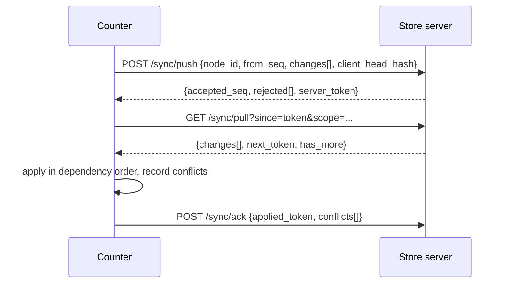

# Offline-first sync architecture

## 1. Goals

- A counter must be able to sell, return, receive stock and take payments with no server (BR-027).
- Convergence must never corrupt stock or financial records (RSK-1).
- Conflicts that cannot be resolved automatically must surface to a human, not be silently dropped.

## 2. Model

Two classes of data with different replication semantics:

| Class | Examples | Semantics |
| --- | --- | --- |
| **Append-only facts** | stock movements, journal lines, invoices, tenders, audit events, notification outbox | Conflict-free: union by `change_id`; ordering by (business_date, node_seq); never updated after post |
| **Mutable masters/settings** | product, price list, party, layout, rule package, settings, user/role | Conflicts possible: resolved by policy (below) |

Documents are immutable once posted; corrections are new documents (reversals). This removes conflict risk from the financially sensitive path entirely — the hard part of sync is reduced to masters.

## 3. Ownership and conflict policy

| Entity | Authoritative writer | Policy |
| --- | --- | --- |
| Product, category, tax class, BOM | Store server (or cloud in multi-store) | Server wins; counters get read-only copies. Counter-side edit requires server reachability |
| Price list / promotion | Server | Server wins; effective-dated so late arrival is harmless |
| Party (customer created at counter) | Any node | Merge: last-writer-wins per field with `updated_at`; duplicates detected by phone HMAC and queued for merge |
| User/role/permission | Server | Server wins; counter caches verifier only |
| Rule package / layout / report template | Server, versioned | Version numbers are server-allocated; counters never author |
| Settings | Server, with node-local overrides namespaced | No conflict by construction |
| Documents | Creating node | Append-only; immutable |
| Sequences | Allocating node | Counter-prefixed ranges (ADR-006) |

Where LWW is used, the loser's value is retained in the conflict record so nothing is lost.

## 4. Protocol

Properties:

- **Idempotent**: every change has a UUID `change_id`; re-delivery is a no-op.
- **Chunked**: batches capped (default 500 changes / 2 MB) with resumable tokens; a counter offline for a month catches up incrementally without a long transaction.
- **Ordered by dependency**: changes carry entity dependencies; the applier topologically sorts within a batch and defers changes whose parents have not arrived.
- **Backpressure**: the server rejects pushes when its own queue or disk is unhealthy; the counter keeps operating locally.
- **Compression + TLS**: gzip body, HTTPS transport.
- **Filtered scope**: a node pulls only what it needs (its store, active masters, open documents, last 90 days of history by default); reporting-only history stays on the server/cloud.

## 5. Store server ↔ cloud

Same protocol one level up, with the store server acting as a client. Cloud scope is typically documents + masters + aggregates; cloud never pushes business documents down (it can push settings, rules, layouts, plugin allow-lists, and support commands). Multi-store consolidation happens in the cloud from replicated documents.

## 6. Conflict handling

A conflict record stores: entity, entity id, local version+payload, remote version+payload, detected_at, policy applied, resolution (AUTO_LOCAL, AUTO_REMOTE, AUTO_MERGE, PENDING, MANUAL_x), resolver, resolved_at. Pending conflicts appear in a manager queue with a field-level diff view. Alert if any conflict is pending > 24 h (NFR-019 alerting).

Duplicate customer detection (same phone created on two counters offline) is a first-class merge flow: choose surviving master, repoint documents, keep an alias row.

## 7. Failure and edge cases

| Case | Handling |
| --- | --- |
| Counter clock is wrong | Server records receive time; sync warns on skew > 60 s; business_date is entered/confirmed at shift open, not derived blindly from the clock |
| Node restored from an old backup | Node's `seq` would regress; server detects `seq` gap/regression and forces a re-seed: local unsynced changes are exported, node re-pairs, exported changes re-pushed with new change_ids |
| Schema version mismatch | Sync halts with a clear message; node stays operational locally (NFR-022) |
| Change log growth while offline for months | Log is local disk only; alert at configurable thresholds (e.g. > 100k pending changes or > 30 days) |
| Server data loss | Server re-seeds from counters' change logs + last backup; append-only documents make this lossless within the counters' retention window |
| Partial batch failure | Whole batch is transactional per chunk; failed chunk retried with exponential backoff; poison change quarantined after N attempts and reported |

## 8. Reconciliation and self-healing

Nightly job on the store server:
1. Recompute stock on hand from movements and compare to `stock_snapshot`.
2. Recompute trial balance and assert debits = credits per period.
3. Compare each node's reported head hash and document counts against server holdings; list missing documents and request them.
4. Publish a reconciliation report; discrepancies raise alerts and, for missing documents, an automatic targeted re-pull.

## 9. Testing strategy for sync

- Deterministic simulation: N virtual nodes, scripted partitions, random operation mixes, assert convergence and invariants (balanced ledger, non-negative stock where configured, no duplicate document numbers).
- Chaos tests: kill server mid-batch, kill counter mid-apply, corrupt a batch, replay old batches, clock jumps.
- Long-offline test: counter offline 30 simulated days with 10k documents, then catch-up within the performance budget.
