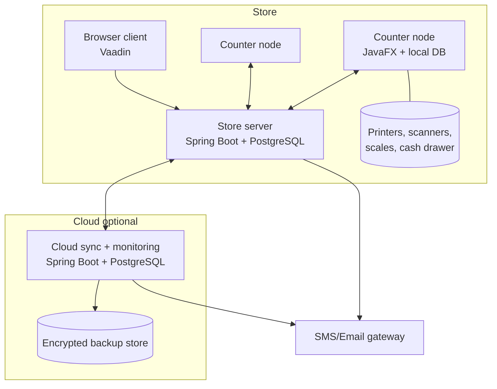
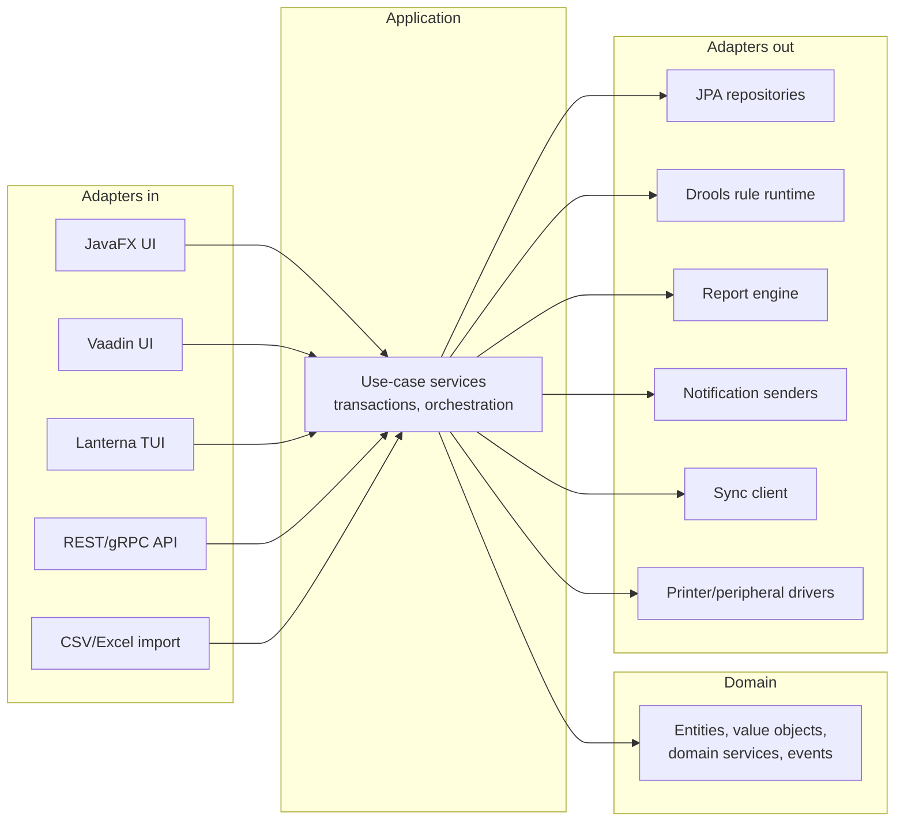

# System architecture

Status: DRAFT · Version 0.1

## 1. Architectural drivers

| Driver | Consequence |
| --- | --- |
| Billing must never stop (BR-027, NFR-007) | Every counter can run a full local stack; server is an optimisation, not a dependency |
| One codebase, many verticals (BR-053) | Hexagonal core + plugin SPI + payload-driven UI + externalised rules |
| Books must always balance (BR-040, NFR-023) | Ledger is append-only, derived from domain events by posting rules, never edited in place |
| Low-spec hardware (NFR-025) | Single JVM per node, no container requirement, modest memory budget |
| Open source only (BR constraint) | JavaFX, Spring Boot, Vaadin, Drools, Hibernate, PostgreSQL, Quartz, JasperReports-free report engine or Apache-licensed alternative |

## 2. Context

## 3. Layering (hexagonal)

Rules: the domain module depends on nothing but the JDK. Application depends on domain + port interfaces. Adapters depend inward only. Enforced by JPMS `requires`/`exports` and ArchUnit tests (NFR-017, NFR-018).

## 4. Runtime topologies

### M1 Standalone
One JVM hosts the JavaFX UI and an embedded Spring application context; PostgreSQL runs as a local service on the same machine. No network required. The sync module is present but idle.

### M2 LAN
Store server runs the Spring Boot application (REST + Vaadin). JavaFX clients connect over HTTPS. The server owns the authoritative store database. Thin clients keep only a read cache.

### M3 Hybrid (default recommendation for retail)
Each counter runs the full local stack (UI + application + local PostgreSQL). Writes are local-first and asynchronously replicated to the store server. The server is the convergence point and the source for reports. Counters that lose the server keep billing.

### M4 Cloud-connected
Store servers sync a filtered subset (documents, masters, aggregates) to a cloud tenant for consolidated reporting, remote monitoring and off-site encrypted backup. The cloud never becomes a runtime dependency for store operations.

Mode is a deployment configuration (`erp.node.role=STANDALONE|COUNTER|STORE_SERVER|CLOUD`), not a code fork.

## 5. Module decomposition (JPMS)

| Module | Responsibility | Depends on |
| --- | --- | --- |
| `erp.core.kernel` | IDs, money, quantity, clock, result types, errors | — |
| `erp.core.domain` | Shared domain: party, product, tax, document numbering, events | kernel |
| `erp.inventory` | Stock, batches, movements, valuation, stock-take, transfers | core.domain |
| `erp.purchasing` | PO, GRN, supplier invoice, landed cost, returns | inventory, accounting.api |
| `erp.sales.pos` | Billing session, cart, tender, drawer, returns | inventory, accounting.api, pricing |
| `erp.pricing` | Price lists, promotions, discounts (rule-backed) | core.domain, rules |
| `erp.accounting` | Chart of accounts, vouchers, GL, posting rules, statements, tax | core.domain |
| `erp.rules` | Drools runtime, rule repository, versioning, simulation | core.domain |
| `erp.reporting` | Report model, designer runtime, renderers (PDF/CSV/XLSX), print | core.domain |
| `erp.notification` | Templates, queue, SMS/email senders, retry | core.domain |
| `erp.analytics` | Aggregations, dashboard queries, forecasting | accounting, inventory, sales |
| `erp.security` | Identity, RBAC, sessions, crypto, audit log | core.domain |
| `erp.sync` | Change capture, transport, merge, conflict queue | core.domain + all persisted modules via change log |
| `erp.platform.ui` | Payload-driven UI engine, component catalogue, binding | core.domain |
| `erp.client.fx` | JavaFX shell, screens, peripherals | platform.ui, app services |
| `erp.client.web` | Vaadin views | platform.ui, REST client |
| `erp.client.tui` | Lanterna screens | app services |
| `erp.server` | Spring Boot app, REST API, scheduling, Vaadin hosting | all |
| `erp.plugin.api` | Plugin SPI + extension points | core.domain |
| `erp.plugin.*` | Textile, paint, hardware, processing plugins | plugin.api |

No cyclic dependencies; cross-module calls go through `*.api` packages and domain events.

## 6. Communication

- **In-process**: application services called directly; domain events published on a synchronous in-JVM event bus with transactional outbox for anything that must escape the JVM.
- **Client ↔ server**: REST/JSON over HTTPS with JWT bearer tokens; long-running/streaming operations (report generation, sync) use chunked responses. gRPC is an option only if REST profiling proves insufficient (ADR-required).
- **Sync**: dedicated endpoints exchanging change batches keyed by sync tokens; idempotent by change ID.
- **Notifications**: transactional outbox → Quartz-driven dispatcher → provider adapter; never in the business transaction.

## 7. Cross-cutting concerns

| Concern | Approach |
| --- | --- |
| Transactions | One application-service call = one DB transaction; domain events published after commit (outbox) |
| Identity | UUIDv7 client-generated; node-scoped document sequences for human-readable numbers |
| Time | UTC everywhere; store timezone for display and for "business date" which is explicit on documents |
| Validation | Domain invariants in the domain layer; payload-UI adds only presentation validation |
| Errors | Typed domain errors mapped to UI messages via message catalogue; no stack traces to users |
| Config | Layered: defaults → node config file → DB-stored tenant settings (sync-able) → user preferences |
| Feature flags | Tenant settings; plugins enabled/disabled per tenant |
| Logging | SLF4J + structured JSON to rolling files; correlation ID per user action; log bundle export |
| Metrics | Micrometer to a local endpoint; pushed to cloud monitoring when connected |
| i18n | Resource bundles per module, externalised, lint-enforced |

## 8. Technology selection summary

| Layer | Choice | Licence | Rationale |
| --- | --- | --- | --- |
| Desktop UI | JavaFX (OpenJFX) 21 | GPLv2+CE | Rich offline client, same language as backend |
| Web UI | Vaadin Flow | Apache-2.0 | Server-side Java UI, no separate JS stack |
| Mobile (Ph.3) | Compose Multiplatform | Apache-2.0 | Kotlin/Java interop, shared domain |
| TUI (Ph.4) | Lanterna | LGPL-3.0 | Minimal hardware fallback |
| Services | Spring Boot 3.x | Apache-2.0 | DI, security, data, scheduling ecosystem |
| Rules | Drools 8.x | Apache-2.0 | Externalised, versionable business rules |
| ORM | Hibernate/JPA | LGPL-2.1 | Mature, PostgreSQL + MySQL support |
| DB | PostgreSQL 15+ (MySQL 8 supported) | PostgreSQL | Reliability, `jsonb`, partial indexes, logical decoding |
| Migrations | Flyway (community) | Apache-2.0 | Forward-only SQL migrations |
| Scheduling | Quartz | Apache-2.0 | Backups, sync, notification dispatch |
| Reports | Custom report model + Apache PDFBox / POI renderers | Apache-2.0 | Avoids LGPL/AGPL reporting suites and heavy designers |
| Build | Gradle, jlink/jpackage | Apache-2.0 | Bundled JRE installers |
| Tests | JUnit 5, AssertJ, Testcontainers, ArchUnit, TestFX, k6 | Apache/MIT | Full pyramid |

Licence policy is enforced in CI (NFR-024). GPL-with-classpath-exception (OpenJFX) and LGPL (Hibernate, Lanterna) are used as unmodified libraries, which keeps distribution obligations limited to providing source/notices.

## 9. Key architectural decisions

See `adr/` for the record; headline decisions:

1. Local-first with asynchronous convergence rather than a shared central database (ADR-001).
2. Movement/event-sourced stock and append-only ledger with derived balances (ADR-002).
3. Payload-driven UI over a fixed component catalogue rather than a generic form builder (ADR-003).
4. Drools for business rules, with rule packages versioned in the database and simulated before activation (ADR-004).
5. Plugins as JPMS layers loaded from a directory, isolated by a narrow SPI (ADR-005).
6. Counter-prefixed document sequences to make offline numbering collision-free (ADR-006).
7. REST/JSON over gRPC for client-server (ADR-007).
8. PostgreSQL as the reference database with a compatibility subset for MySQL (ADR-008).
