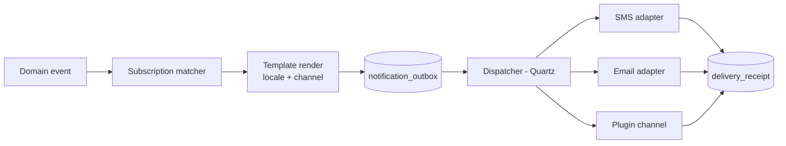

# Notification service design

Implements BR-060, BR-061.

## 1. Requirements recap

Template-based SMS/email for invoices, payment reminders, low stock, expiry, promotions and day-close summaries; created reliably even when offline; never blocking a business transaction.

## 2. Pipeline



The outbox write happens **inside** the business transaction (so a sale and its receipt notification commit atomically); delivery happens outside it, asynchronously.

## 3. Data model

| Table | Key fields |
| --- | --- |
| `notification_template` | id, code, channel, locale, subject, body, version, status |
| `notification_subscription` | id, event_type, condition (restricted expression), template_code, recipient_resolver, channel, enabled, quiet_hours |
| `notification_outbox` | id, tenant, store, channel, recipient, rendered_subject, rendered_body, dedupe_key, priority, scheduled_at, status, attempts, last_error, created_at |
| `delivery_receipt` | outbox_id, provider_ref, status, provider_status, received_at |

`status`: `PENDING → SENDING → SENT → DELIVERED | FAILED | CANCELLED | EXPIRED`.

## 4. Templates

Mustache-style placeholders over a documented context per event:

```
Dear {{customer.name}}, thank you for shopping at {{store.name}}.
Bill {{invoice.number}} dated {{invoice.date}} for {{invoice.grandTotal}}.
{{#invoice.savings}}You saved {{invoice.savings}}.{{/invoice.savings}}
```

Rules: SMS templates are length-checked (single/multi-part segment count shown in the editor); templates are versioned and audited like layouts; per-locale variants; a preview renders with sample data; unknown placeholders fail validation at save, not at send.

## 5. Channels and adapters

| Channel | Adapter | Config |
| --- | --- | --- |
| SMS | Generic HTTP gateway adapter: URL, method, headers, body template, success matcher, error mapping | Per tenant, credentials encrypted |
| Email | Jakarta Mail SMTP with STARTTLS/implicit TLS | Host, port, credentials, from, reply-to |
| Plugin | `NotificationChannel` SPI (WhatsApp, push, printer-as-channel) | Plugin-defined |

The generic SMS adapter exists because shops use whichever local provider is cheapest; no code change should be needed to switch provider.

## 6. Reliability

- **Retry**: exponential backoff (30 s, 2 m, 10 m, 1 h, 6 h) with jitter, max 5 attempts, then `FAILED` with the provider error retained.
- **Dedupe**: `dedupe_key` (e.g. `invoice:{id}:receipt`) prevents duplicates after crashes or re-sync.
- **Ordering**: not guaranteed globally; per-recipient ordering is best-effort via priority + scheduled_at.
- **Offline**: outbox accumulates on the counter; dispatch happens on whichever node has connectivity — outbox rows sync to the store server, which owns dispatch by default (a `dispatch_owner` field prevents double-sending).
- **Expiry**: time-sensitive messages (OTP-like, promotions) carry a TTL and are `EXPIRED` rather than sent late.
- **Quiet hours & rate limits**: per tenant (e.g. no promotional SMS 21:00–08:00); transactional messages bypass quiet hours; per-recipient daily caps prevent spamming a customer.
- **Consent**: customers carry `smsOptIn`/`emailOptIn` flags; promotional subscriptions respect them, transactional ones do not require opt-in but respect a global block flag.

## 7. Cost control and observability

Per-tenant counters of messages sent by channel and template, with a monthly budget and alert; a dashboard shows send/deliver/fail rates and the top failure reasons. Failed sends older than 24 h raise an operational alert (NFR-019).

## 8. Default subscriptions shipped

| Event | Template | Recipient | Channel |
| --- | --- | --- | --- |
| `SaleCompleted` (customer has phone, opted in) | `sale.receipt` | customer | SMS |
| `SaleCompleted` (customer has email) | `sale.invoice` | customer | Email + PDF attachment |
| `PaymentDue` (scheduled job) | `ar.reminder` | customer | SMS |
| `StockBelowReorder` | `stock.reorder` | store manager | Email |
| `BatchNearExpiry` (daily digest) | `stock.expiry` | store manager | Email |
| `DrawerClosed` variance > threshold | `cash.variance` | owner | SMS |
| Day close | `store.dayclose` | owner | SMS + Email |
| Backup failed twice / no sync 24 h | `ops.alert` | owner + support | Email |

All are enabled/disabled per tenant and fully editable.
