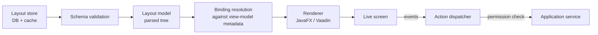

# Payload-driven UI engine design

Implements BR-050 under the constraints of ADR-003.

## 1. Concepts

| Concept | Meaning |
| --- | --- |
| **Layout** | A versioned JSON document describing one screen |
| **Component** | An entry from the fixed catalogue (`textField`, `grid`, …) |
| **Binding** | A path into the screen's data context (`item.qty`, `header.customer.phone`) |
| **Action** | A named, code-implemented operation the screen may invoke (`sales.finalise`) |
| **Renderer** | Platform-specific translator: `FxRenderer`, `VaadinRenderer` |
| **Data context** | A mutable observable tree supplied by the screen's view-model |

## 2. Engine pipeline



Layouts are resolved with precedence: **user preference → tenant override → plugin contribution → product default**. Each level is a patch (JSON Merge Patch) over the previous, so upgrades to the default flow through unless explicitly overridden.

## 3. Component catalogue (v1)

`section`, `tabs`, `row`, `column`, `spacer`, `label`, `textField`, `numberField`, `moneyField`, `dateField`, `checkbox`, `comboBox`, `lookupField` (async search against a named query), `grid` (columns, sorting, inline edit, footer aggregates), `matrixGrid` (two-dimension variant entry), `imageField`, `barcodeField`, `summaryPanel`, `actionBar`, `statusBadge`, `chart` (read-only, from a named analytics query), `pluginSlot`.

Each component declares: `id`, `type`, `bind`, `label`, `visibleWhen`, `enabledWhen`, `requiredWhen`, `validators[]`, `shortcut`, `props{}` (type-specific), `permissions[]`.

Conditions (`visibleWhen` etc.) are restricted expressions over the data context and user context — comparisons, boolean operators, `in`, `isEmpty` — evaluated by a sandboxed evaluator with no method calls, no I/O, and a node-count limit. This is deliberately not a scripting language.

## 4. Example layout

```json
{
  "layoutId": "purchase.receipt",
  "version": 7,
  "title": "Goods Receipt",
  "dataContext": "purchase.goodsReceipt",
  "root": {
    "type": "column",
    "children": [
      { "type": "section", "label": "Header", "children": [
        { "type": "row", "children": [
          { "type": "lookupField", "id": "supplier", "bind": "header.supplierId",
            "label": "Supplier", "props": { "query": "party.suppliers", "minChars": 2 },
            "requiredWhen": "true", "shortcut": "F3" },
          { "type": "textField", "id": "supplierDoc", "bind": "header.supplierDocNo", "label": "Supplier Invoice #" },
          { "type": "dateField", "id": "docDate", "bind": "header.documentDate", "label": "Date" }
        ]}
      ]},
      { "type": "grid", "id": "lines", "bind": "lines", "props": {
        "columns": [
          { "bind": "variantId", "type": "lookupField", "label": "Item", "props": { "query": "catalogue.variants" }, "width": 260 },
          { "bind": "batchCode",  "type": "textField",   "label": "Batch",  "visibleWhen": "row.item.batchTracked" },
          { "bind": "expiryDate", "type": "dateField",   "label": "Expiry", "visibleWhen": "row.item.expiryTracked",
            "validators": [ { "type": "afterToday", "message": "validation.expiry.past" } ] },
          { "bind": "qty",        "type": "numberField", "label": "Qty", "props": { "scale": 3 } },
          { "bind": "cost",       "type": "moneyField",  "label": "Cost" },
          { "bind": "amount",     "type": "moneyField",  "label": "Amount", "props": { "readOnly": true } }
        ],
        "footer": [ { "bind": "qty", "agg": "sum" }, { "bind": "amount", "agg": "sum" } ]
      }},
      { "type": "actionBar", "children": [
        { "type": "action", "id": "save",  "label": "Save Draft", "action": "purchase.receipt.saveDraft", "shortcut": "Ctrl+S" },
        { "type": "action", "id": "post",  "label": "Post", "action": "purchase.receipt.post",
          "permissions": ["purchasing.receipt.post"], "enabledWhen": "lines.length > 0", "primary": true }
      ]}
    ]
  }
}
```

## 5. Data contexts and view-models

A layout may only bind to a **registered data context** published by code (`purchase.goodsReceipt`), which declares its field metadata (type, scale, required, editable, lookup query). Binding resolution fails fast at publish time if a layout references an unknown path, so a broken layout can never reach production. Metadata also drives default formatting and validation, so layouts stay short.

## 6. Validation layers

1. **Schema**: the layout JSON is validated against the layout JSON Schema.
2. **Binding**: every `bind` exists in the declared data context; every `action` is registered; every permission exists.
3. **Budget**: ≤ 120 bound components, ≤ 3 nesting levels of grids, ≤ 40 conditions per screen.
4. **Runtime**: presentation validators; domain invariants remain authoritative and are always re-checked server-side.

## 7. Versioning and lifecycle

`layout` (identity) → `layout_version` (payload, author, status DRAFT/PUBLISHED/ARCHIVED, published_by, published_at). Editing creates a new draft; publishing requires `platform.layout.publish` permission, is audited (CMP), and propagates through sync. Rollback republishes a previous version. Nodes cache compiled layouts keyed by (layoutId, version) and invalidate on `LayoutPublished`.

## 8. Layout editor

An admin screen with a component palette, a tree/canvas view, a property sheet, live preview against sample data, a diff view versus the published version, and validation errors inline. The editor writes the same JSON that can also be hand-edited or shipped by a plugin; import/export as files supports implementer workflows.

## 9. Performance

Parsed layouts are cached as immutable models; renderers build the JavaFX scene graph once per screen instance and reuse nodes for grid virtualisation. Target: first paint ≤ 300 ms for a budget-compliant layout on reference hardware, measured by an automated TestFX benchmark in CI.

## 10. Plugin contributions

Plugins contribute whole layouts (new screens) or patches to existing ones (add a section/field into a named `pluginSlot`). Patches are applied in plugin-load order with conflict detection; a patch targeting a missing slot is a load-time warning, not a crash.
