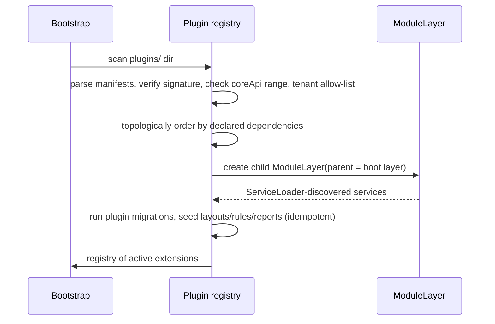

# Plugin framework design

Implements BR-053 under ADR-005.

## 1. Anatomy of a plugin

```
erp-plugin-textile/
├── module-info.java            # requires erp.plugin.api; provides ...
├── plugin.json                 # manifest
├── layouts/                    # layout payloads and patches
├── rules/                      # DRL packages seeded on install
├── reports/                    # report templates
├── migrations/                 # Flyway migrations in the plugin's own schema
└── src/                        # SPI implementations
```

`plugin.json`:

```json
{
  "id": "com.openretail.textile",
  "name": "Textile pack",
  "version": "1.2.0",
  "coreApi": ">=1.0.0 <2.0.0",
  "extensionPoints": ["ScreenContribution", "PriceResolver", "ImportProfileProvider"],
  "schema": "plugin_textile",
  "permissions": ["catalogue.variant.matrixEdit"],
  "settings": [ { "key": "defaultSizeSet", "type": "string", "default": "S,M,L,XL" } ]
}
```

## 2. Loading



Failure during load disables the plugin and records a diagnostic; the node still starts (a shop must be able to bill even if a vertical pack is broken).

## 3. Extension points (v1)

| SPI | Purpose | Cardinality |
| --- | --- | --- |
| `ScreenContribution` | Add screens or patch existing layouts via `pluginSlot` | many |
| `PriceResolver` | Replace/augment price resolution | one authoritative + observers |
| `TaxCalculator` | Jurisdiction-specific tax | one per jurisdiction |
| `DocumentNumberingStrategy` | Alternative numbering | one |
| `PaymentProcessor` | Card/UPI/wallet integrations | many, selected by tender type |
| `NotificationChannel` | New channels (WhatsApp, push) | many |
| `ImportProfileProvider` / `ExportFormat` | File integrations | many |
| `ReportDataSource` | New named queries for the designer | many |
| `PeripheralDriver` | Scales, displays, printers | many |
| `DomainEventListener` | React to core events | many |
| `ValidationContributor` | Extra document validations | many |
| `EntityAttributeSchema` | Declare and validate `attributes jsonb` fields | many |
| `MenuContribution` | Navigation entries | many |

Contract rules: SPI types use only `erp.plugin.api` and JDK types; all calls are synchronous with a documented timeout; implementations must be thread-safe and side-effect-free except through provided services; plugins never touch core tables directly — they use published application services and their own schema.

## 4. Data extension

Two mechanisms:
1. **`attributes jsonb`** on core entities, with the plugin declaring a JSON Schema (`EntityAttributeSchema`) that the core validates on save and that layouts can bind to (`attributes.textile.fabricGsm`).
2. **Own schema** (`plugin_textile`) for plugin-owned tables, migrated by the plugin's own Flyway location, synced through the standard change-log mechanism by registering the tables with the sync module.

Core never has foreign keys into plugin schemas; plugin tables may reference core entity ids without a DB-level FK (validated in application code) so that disabling a plugin cannot break core integrity.

## 5. Planned plugins

| Plugin | Contents |
| --- | --- |
| **Textile** | Size × colour matrix entry and billing, per-metre sale, season markdown rules, matrix purchase import, barcode-per-variant generation |
| **Paint & hardware** | Base + tint mixing with formula recording and cost roll-up, loose sale from bulk packs with UOM conversion at sale, contractor credit terms, shade-card lookup |
| **Processing / assembly** | BOM versions, production orders, yield/scrap tracking, costing with overhead, by-product handling |
| **Departmental / grocery** | Weight-embedded barcodes, scale integration, expiry-driven markdown, combo/bundle pricing, loyalty tiers |
| **e-Invoicing / e-Way** | Jurisdiction payload generation, submission, acknowledgement storage |
| **Payments** | Card/UPI terminal integrations per vendor |

Each plugin ships its own layouts, rules, reports and test suite, and is built and released independently against a declared core API range.

## 6. Versioning and compatibility

Core API follows semver. A plugin declares a `coreApi` range; a plugin outside the range is refused with a clear message. The core keeps an API compatibility test module; breaking changes require a major bump plus a documented migration. A reference plugin in the repo is built in CI against the current core so accidental breaks are caught at commit time.

## 7. Lifecycle operations

Install (drop JAR + enable in admin UI + restart), enable/disable per tenant, upgrade (replace JAR; migrations run on next start), uninstall (disable, then data retention decision: keep plugin schema read-only by default; purge requires explicit confirmation and is audited). Node health reports plugin id/version/status; multi-store owners see plugin drift across stores.
