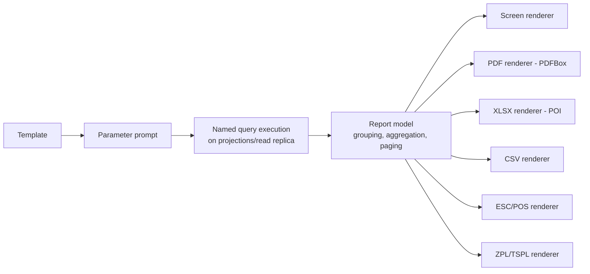

# Report designer and printing design

Implements BR-052, BR-054.

## 1. Scope

Three artefact families share one engine:

| Family | Output | Examples |
| --- | --- | --- |
| Reports | Screen, PDF, CSV, XLSX | Trial balance, stock ageing, sales register |
| Documents | Thermal (ESC/POS) or A4 PDF | Invoice, credit note, PO, day-close summary |
| Labels | ZPL/TSPL or raster | Shelf label, barcode label, batch label |

## 2. Report model

A report template is JSON with three parts:

```json
{
  "templateId": "stock.ageing",
  "version": 3,
  "dataSource": { "query": "inventory.stockAgeing",
                  "parameters": [ { "name": "asOf", "type": "date", "required": true },
                                  { "name": "categoryId", "type": "uuid" } ] },
  "model": {
    "groups": [ { "by": "categoryName", "header": true, "footer": true } ],
    "columns": [
      { "field": "itemName", "label": "Item", "width": 240 },
      { "field": "batchCode", "label": "Batch", "visibleWhen": "params.showBatches" },
      { "field": "qty", "label": "Qty", "align": "right", "format": "qty" },
      { "field": "value", "label": "Value", "align": "right", "format": "money", "agg": "sum" },
      { "field": "ageDays", "label": "Age (d)", "align": "right" }
    ],
    "filters": [ { "field": "ageDays", "op": ">=", "value": 0 } ],
    "sort": [ { "field": "ageDays", "dir": "desc" } ]
  },
  "layout": { "page": "A4", "orientation": "portrait", "header": [...], "footer": [...] }
}
```

**Data sources are named, registered queries** contributed by modules and plugins — never free SQL from the designer (security §5). Each data source declares its parameters, output fields and required permission, so report access inherits RBAC and data scoping automatically.

## 3. Designer UX

Drag-and-drop canvas with: data-source picker, field list, band editor (report header, page header, group header, detail, group footer, page footer, summary), property sheet (format, alignment, width, conditional formatting), expression fields (restricted expression language over row/group/parameter values — arithmetic, aggregates, conditionals; no I/O), live preview with sample or real data, and page setup per printer profile. Designer output is the same JSON that can be exported/imported as a file and shipped by plugins.

## 4. Rendering pipeline



Large reports stream: the query is cursor-based and the renderer writes incrementally, so memory stays bounded (NFR-025). Long reports run asynchronously with progress and land in a "My reports" area with retention.

## 5. Printing

- **Printer profiles** per counter: device (USB/serial/network/OS), language (ESC/POS, ZPL, PDF), paper width (58/80 mm/A4/A5), character set/codepage, cut/drawer-kick behaviour, copies, logo bitmap.
- Documents bind to a profile by role (`receipt`, `a4Invoice`, `label`, `report`), so the same invoice template prints thermally at the counter and as A4 in the office.
- Spooling: print jobs are queued and retried; a failed job never blocks the business transaction (BR-024) and is visible in a print queue UI with retry/cancel/reprint. Reprints are audited when the document is financial.
- Preview-before-print is available everywhere; thermal preview renders a monospaced facsimile at the configured width.

## 6. Built-in templates (ship with the product)

Invoice (thermal, A4), credit note, purchase order, GRN, payment/receipt voucher, day-close summary, drawer variance, sales register, sales by item/category/cashier, stock on hand, stock ageing, near-expiry, reorder, stock movement ledger, stock-take variance, supplier/customer ledger and ageing, day book, ledger statement, trial balance, P&L, balance sheet, cash/bank book, tax summary, HSN summary, shelf and batch labels.

Built-ins are read-only; "Save as" creates a tenant copy that can be edited. Upgrades refresh built-ins without touching tenant copies.

## 7. Versioning and localisation

Templates are versioned like layouts (draft → published, audited, sync-replicated, rollback-able). Labels inside templates are message keys resolved per locale, so one template serves multiple languages; per-locale overrides are possible for statutory wording.

## 8. Performance and limits

Budgets: ≤ 200k rows for interactive reports (beyond that, export-only), first page ≤ 2 s, full A4 PDF of 10k rows ≤ 15 s, thermal invoice render + spool ≤ 300 ms. Queries must be backed by projections (data architecture §5); a data source whose query exceeds its budget in CI fails the build.
