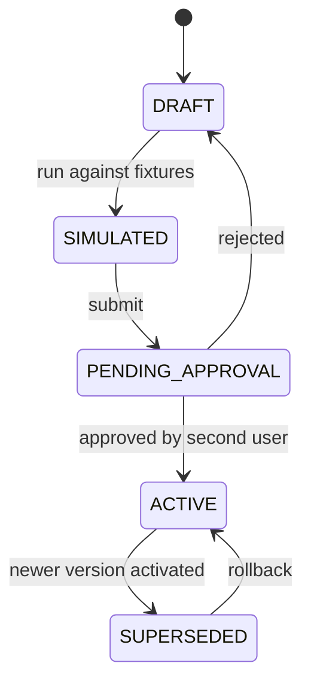

# Business rules engine design (Drools)

Implements BR-051 under ADR-004.

## 1. Decision points

Only these are rule-driven in v1. Everything else stays in code.

| Decision point | Input facts | Output | Latency budget |
| --- | --- | --- | --- |
| `PRICE_RESOLUTION` | Variant, Customer/Group, Qty, Date, Store, Channel | `PriceDecision(unitPrice, priceListRef, reason)` | 10 ms |
| `DISCOUNT_ELIGIBILITY` | Cart snapshot, Customer, Promotions, User role | `DiscountDecision(lineDiscounts[], billDiscount, requiresApproval, limits)` | 20 ms |
| `TAX_DETERMINATION` | Line (HSN, tax class), Store state, Customer state, Exemptions | `TaxDecision(components[rate, base, amount])` | 10 ms |
| `APPROVAL_ROUTING` | Operation, amount/percent, actor role | `ApprovalDecision(required, approverPermission, escalation)` | 5 ms |
| `LOYALTY_ACCRUAL` | Invoice snapshot, Customer tier | `LoyaltyDecision(points, expiry)` | 10 ms |
| `REORDER_SUGGESTION` | Variant history, lead time, seasonality | `ReorderDecision(suggestedQty, supplier)` | batch job |
| `NEAR_EXPIRY_ACTION` | Batch, days to expiry, stock value | `ExpiryDecision(markdownPct, alert)` | batch job |
| `VALIDATION_EXTRA` | Document snapshot | `ValidationMessages[]` (warnings/blocks) | 10 ms |

Each decision point is a Java interface plus fact/decision records in `erp.rules.api`; the Drools implementation is one of possibly several providers (a plugin may replace a decision point wholesale).

## 2. Execution model

```java
public interface DecisionService {
    <F, D> D decide(DecisionPoint<F, D> point, F facts);
}
```

- One `KieBase` per rule package version, cached; stateless sessions per evaluation.
- Rules are **pure**: no DB access, no I/O, no mutation of ERP entities. Facts are immutable records built by the caller; the decision is inserted as a mutable result object.
- `agenda-group` per decision point; `salience` restricted to a documented range; `no-loop true` default.
- Guard rails: max 200 activations and a hard wall-clock timeout per evaluation. On breach: use last-known-good version's cached decision for identical facts, else the code default; raise a `RuleBudgetExceeded` alert; never block the sale.

## 3. Rule authoring model

```
rule "TXT-SEASONAL-MARKDOWN"
  agenda-group "PRICE_RESOLUTION"
  salience 50
when
  $f : PriceFacts( variant.categoryCode == "SAREE",
                   date >= "2026-11-01", date <= "2026-12-31" )
  $d : PriceDecision()
then
  $d.applyPercentOff(15, "Seasonal markdown 2026");
end
```

Authors work in a rule editor screen with: a fact-model browser (available fields per decision point), syntax validation, a template library ("percent off category in date range", "tiered discount by amount", "tax exemption by customer type") that generates DRL for non-programmers, and a free DRL mode for power users.

## 4. Lifecycle and governance



- **Simulation is mandatory**: the candidate version is evaluated against a fixture set (curated cases + the last N real transactions, anonymised) and the UI shows a decision diff (which invoices change, by how much, total revenue/tax impact). Activation is blocked if the diff was not reviewed.
- **Four-eyes**: `platform.rule.activate` cannot be exercised by the author when the tenant enables four-eyes.
- Every transition is audited with actor, timestamp, diff hash (CMP audit list).
- Activation propagates by sync; nodes compile the new version in the background and switch atomically after warm-up.

## 5. Traceability

Every decision returns a `reason` trail (which rules fired, which price list/promotion applied). The trail is stored with the invoice line (compact JSON) so "why was this price/tax/discount applied?" is answerable months later, including after the rule has changed — critical for disputes and audits.

## 6. Testing

- Unit: each rule package has DRL test cases (facts → expected decision) runnable in CI.
- Property tests: e.g. discount never makes the line negative; tax components always sum to the computed total; price never below a configured floor unless a markdown rule explicitly allows it.
- Regression: the fixture corpus runs on every core release to detect Drools upgrade drift.
- Performance: a benchmark asserts each decision point's latency budget with the tenant's largest rule package.

## 7. Failure and fallback

| Failure | Behaviour |
| --- | --- |
| Compilation error on activation | Activation rejected; previous version stays active; author sees the error |
| Runtime exception in a rule | Decision falls back to code default; alert; offending rule flagged and quarantined after repeated failures |
| Missing rule package on a node | Code defaults used; node health reports degraded rules; sync repairs |
| Latency budget exceeded | See §2 |

Ledger-affecting logic (posting rules, balancing, period locks, numbering) is never rule-driven, so no rule failure can produce unbalanced books.
