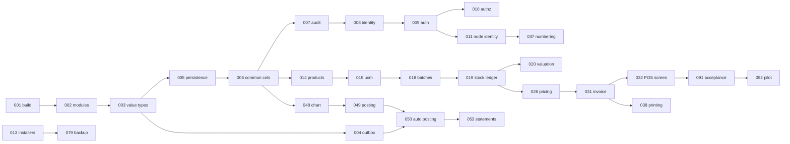

# Implementation task backlog

92 individual task documents, one per file (`TASK-nnn-<slug>.md`). Each states goal, scope in/out, implementation notes that capture the non-obvious decisions, acceptance criteria and a definition of done, and traces to `BR-`/`FR-`/`NFR-`/`ADR-` identifiers.

## How to use these

- A task is a unit of delivery, not a sprint: sizes are S (≤1 session), M (1–2 sessions), L (2–4 sessions), XL (split before starting).
- `Depends on` lists the hard technical prerequisite only. Soft ordering is captured by phase.
- Do not start an XL task without splitting it into child tasks that each have their own acceptance criteria.
- Acceptance criteria are the review contract. If a criterion cannot be demonstrated, the task is not done, regardless of code completeness.
- Every task inherits the definition of done in `docs/00-overview/conventions.md`.

## Critical path (Phase 1 MVP: one shop can bill, count stock and close its books)

## Phase groupings

| Phase | Theme | Tasks |
| --- | --- | --- |
| 1 | Core ERP on a single offline node: foundations, inventory, POS, accounting, installers, backup | 001–056 (excluding phase-tagged exceptions), 075, 079, 086 |
| 2 | LAN and web: store server, REST API, thin/hybrid clients, Vaadin, designers, notifications, analytics, plugins, hardening, upgrade, docs, release gates | 057–066, 069–075, 080, 082–086, 090–092 |
| 3 | Sync at scale, vertical plugins, mobile | 067, 068, 076–078, 081, 088 |
| 4 | Terminal resilience | 087 |
| 5 | Cloud tier, forecasting, webhooks | 066, 071, 089 |

Tasks appear under the earliest phase that needs them; a task's own document carries the authoritative phase.

## Recommended MVP cut (smallest thing worth putting in a real shop)

001–011, 013, 014–016, 018, 019, 026, 030–035, 037, 038, 039, 048–050, 053, 055, 075, 079, 091. Everything else is deferrable without making the product unusable — this is the list to defend when scope pressure arrives.

## Index

| Task | Title | Phase | Size | Depends on | Role |
| --- | --- | --- | --- | --- | --- |
| [TASK-001](TASK-001-repo-and-build-skeleton.md) | Repository, Gradle multi-module skeleton and build conventions | 1 | M | — | DevOps |
| [TASK-002](TASK-002-jpms-module-graph.md) | JPMS module graph and architecture enforcement | 1 | M | TASK-001 | Architect |
| [TASK-003](TASK-003-core-value-types.md) | Core kernel value types: Money, Quantity, ids, clock | 1 | M | TASK-002 | Core backend |
| [TASK-004](TASK-004-event-bus-and-outbox.md) | Domain event bus and transactional outbox | 1 | M | TASK-003 | Core backend |
| [TASK-005](TASK-005-persistence-baseline.md) | Persistence baseline: JPA, Flyway, dual-dialect test harness | 1 | M | TASK-003 | Core backend |
| [TASK-006](TASK-006-common-columns-and-concurrency.md) | Common columns, optimistic concurrency and soft delete | 1 | S | TASK-005 | Core backend |
| [TASK-007](TASK-007-audit-log-hash-chain.md) | Tamper-evident audit log with hash chaining | 1 | M | TASK-006 | Core backend |
| [TASK-008](TASK-008-identity-model.md) | Identity model: users, roles, permissions, data scopes | 1 | M | TASK-006 | Core backend |
| [TASK-009](TASK-009-authentication.md) | Authentication: login, password policy, offline cached credentials, JWT | 1 | L | TASK-008 | Core backend |
| [TASK-010](TASK-010-authorization-enforcement.md) | Authorization enforcement and data scoping | 1 | M | TASK-009 | Core backend |
| [TASK-011](TASK-011-node-identity-and-pairing.md) | Node identity, registration and pairing | 1 | M | TASK-009 | Core backend |
| [TASK-012](TASK-012-observability-baseline.md) | Observability baseline: structured logging, metrics, diagnostics bundle | 1 | M | TASK-001 | DevOps |
| [TASK-013](TASK-013-installers-and-packaging.md) | Installer and packaging: jlink/jpackage with embedded runtime and database | 1 | L | TASK-001 | DevOps |
| [TASK-014](TASK-014-product-and-variant-master.md) | Product and variant master | 1 | L | TASK-006 | Core backend |
| [TASK-015](TASK-015-units-of-measure.md) | Units of measure and conversions | 1 | M | TASK-014 | Core backend |
| [TASK-016](TASK-016-barcodes-and-labels.md) | Barcodes, labels and item identification | 1 | M | TASK-014 | Core backend |
| [TASK-017](TASK-017-tax-classes.md) | Tax classes and tax configuration | 1 | M | TASK-014 | Accounting specialist |
| [TASK-018](TASK-018-batches-and-expiry.md) | Batches, expiry and FEFO | 1 | L | TASK-015 | Core backend |
| [TASK-019](TASK-019-stock-movement-ledger.md) | Stock movement ledger and on-hand projection | 1 | L | TASK-018 | Core backend |
| [TASK-020](TASK-020-inventory-valuation.md) | Inventory valuation: weighted average and FIFO | 1 | L | TASK-019 | Accounting specialist |
| [TASK-021](TASK-021-stock-take.md) | Stock take and adjustments | 1 | M | TASK-019 | Core backend |
| [TASK-022](TASK-022-stock-transfers.md) | Inter-store and internal transfers | 1 | M | TASK-019 | Core backend |
| [TASK-023](TASK-023-bom-and-production.md) | Bills of material, assembly and production | 1 | L | TASK-020 | Core backend |
| [TASK-024](TASK-024-paint-tinting-and-loose-stock.md) | Paint tinting and loose/bulk handling | 1 | M | TASK-023 | Core backend |
| [TASK-025](TASK-025-reorder-and-stock-alerts.md) | Reorder levels, stock alerts and suggestions | 1 | M | TASK-019 | Core backend |
| [TASK-026](TASK-026-price-lists-and-resolution.md) | Price lists and price resolution | 1 | M | TASK-017 | Core backend |
| [TASK-027](TASK-027-drools-decision-service.md) | Drools integration and the decision service | 1 | L | TASK-004 | Rules engineer |
| [TASK-028](TASK-028-rule-authoring-and-simulation.md) | Rule authoring, simulation and activation workflow | 1 | L | TASK-027 | Rules engineer |
| [TASK-029](TASK-029-discounts-and-approvals.md) | Discounts, overrides and approval workflow | 1 | M | TASK-028 | Core backend |
| [TASK-030](TASK-030-counter-sessions-and-day-close.md) | Counter sessions, cash drawer and day close | 1 | M | TASK-011 | Core backend |
| [TASK-031](TASK-031-sales-invoice-aggregate.md) | Sales invoice aggregate and finalisation | 1 | L | TASK-026 | Core backend |
| [TASK-032](TASK-032-pos-billing-screen.md) | POS screen: keyboard-first billing UI | 1 | XL | TASK-031 | UI engineer |
| [TASK-033](TASK-033-tenders-and-payments.md) | Tenders, split payments and payment terminals | 1 | M | TASK-031 | Core backend |
| [TASK-034](TASK-034-hold-and-recall.md) | Hold, recall, park and multi-bill handling | 1 | S | TASK-032 | UI engineer |
| [TASK-035](TASK-035-sales-returns-and-exchanges.md) | Sales returns, exchanges and credit notes | 1 | L | TASK-031 | Core backend |
| [TASK-036](TASK-036-customers-credit-and-loyalty.md) | Customers, credit accounts and loyalty | 1 | L | TASK-031 | Core backend |
| [TASK-037](TASK-037-offline-document-numbering.md) | Offline document numbering and series management | 1 | M | TASK-011 | Core backend |
| [TASK-038](TASK-038-document-printing.md) | Receipt, invoice and document printing | 1 | M | TASK-031 | UI engineer |
| [TASK-039](TASK-039-peripheral-adapters.md) | Peripheral adapters: scanner, scale, drawer, customer display | 1 | M | TASK-032 | UI engineer |
| [TASK-040](TASK-040-supplier-master.md) | Supplier master and purchasing setup | 1 | M | TASK-017 | Core backend |
| [TASK-041](TASK-041-purchase-orders.md) | Purchase orders | 1 | M | TASK-040 | Core backend |
| [TASK-042](TASK-042-goods-receipts.md) | Goods receipt notes | 1 | L | TASK-041 | Core backend |
| [TASK-043](TASK-043-purchase-invoices-and-matching.md) | Purchase invoices and three-way matching | 1 | L | TASK-042 | Accounting specialist |
| [TASK-044](TASK-044-purchase-returns.md) | Purchase returns and debit notes | 1 | M | TASK-043 | Core backend |
| [TASK-045](TASK-045-landed-costs.md) | Landed costs and cost allocation | 1 | M | TASK-043 | Accounting specialist |
| [TASK-046](TASK-046-supplier-payments-and-payables.md) | Supplier payments and payables | 1 | M | TASK-043 | Accounting specialist |
| [TASK-047](TASK-047-supplier-catalogue-import.md) | Supplier catalogue and price-list import | 1 | M | TASK-040 | Core backend |
| [TASK-048](TASK-048-chart-of-accounts.md) | Chart of accounts and accounting masters | 1 | M | TASK-006 | Accounting specialist |
| [TASK-049](TASK-049-posting-engine.md) | Voucher entry and the double-entry posting engine | 1 | XL | TASK-048 | Accounting specialist |
| [TASK-050](TASK-050-automatic-posting-rules.md) | Automatic posting rules from domain events | 1 | L | TASK-049 | Accounting specialist |
| [TASK-051](TASK-051-party-ledgers-and-statements.md) | Party ledgers, statements and reconciliation | 1 | M | TASK-050 | Accounting specialist |
| [TASK-052](TASK-052-tax-ledgers-and-exports.md) | Tax ledgers and statutory exports | 1 | L | TASK-050 | Accounting specialist |
| [TASK-053](TASK-053-financial-statements.md) | Financial statements: trial balance, P&L, balance sheet | 1 | L | TASK-049 | Accounting specialist |
| [TASK-054](TASK-054-bank-and-reconciliation.md) | Bank accounts, cash book and reconciliation | 1 | M | TASK-049 | Accounting specialist |
| [TASK-055](TASK-055-period-locks-and-year-close.md) | Period locks, year-end close and opening carry-forward | 1 | M | TASK-053 | Accounting specialist |
| [TASK-056](TASK-056-cost-centres.md) | Cost centres and dimensional reporting | 1 | S | TASK-049 | Accounting specialist |
| [TASK-057](TASK-057-payload-ui-schema.md) | Payload-driven UI: schema, validator and runtime contract | 1 | L | TASK-003 | UI engineer |
| [TASK-058](TASK-058-fx-payload-renderer.md) | JavaFX renderer for payload-driven screens | 2 | L | TASK-057 | UI engineer |
| [TASK-059](TASK-059-layout-designer.md) | Layout designer (admin) | 2 | L | TASK-058 | UI engineer |
| [TASK-060](TASK-060-report-engine.md) | Report model, data sources and renderers | 2 | L | TASK-005 | Core backend |
| [TASK-061](TASK-061-report-designer.md) | Drag-and-drop report designer | 2 | L | TASK-060 | UI engineer |
| [TASK-062](TASK-062-printing-service.md) | Printing service, spooling and printer profiles | 2 | M | TASK-060 | Core backend |
| [TASK-063](TASK-063-notification-service.md) | Notification service: templates, channels and delivery | 2 | L | TASK-004 | Core backend |
| [TASK-064](TASK-064-notification-subscriptions.md) | Notification subscriptions and alert catalogue | 2 | M | TASK-063 | Core backend |
| [TASK-065](TASK-065-analytics-dashboards.md) | Analytics projections and dashboards | 2 | L | TASK-019 | Core backend |
| [TASK-066](TASK-066-demand-forecasting.md) | Demand forecasting and explainable suggestions | 5 | M | TASK-065 | Core backend |
| [TASK-067](TASK-067-sync-protocol.md) | Change log, sync protocol and server endpoints | 3 | XL | TASK-006 | Architect |
| [TASK-068](TASK-068-sync-agent-and-reconciliation.md) | Sync agent, conflict records and reconciliation jobs | 3 | L | TASK-067 | Core backend |
| [TASK-069](TASK-069-store-server-and-rest-api.md) | Store server application and REST API v1 | 2 | L | TASK-010 | Core backend |
| [TASK-070](TASK-070-thin-client-mode.md) | Thin-client mode for the JavaFX client | 2 | M | TASK-069 | UI engineer |
| [TASK-071](TASK-071-webhooks.md) | Webhooks and outbound integration events | 5 | S | TASK-069 | Core backend |
| [TASK-072](TASK-072-vaadin-web-client.md) | Vaadin web client (Phase 2) | 2 | XL | TASK-069 | Web UI engineer |
| [TASK-073](TASK-073-plugin-spi-and-loader.md) | Plugin SPI, loader and lifecycle | 2 | L | TASK-002 | Architect |
| [TASK-074](TASK-074-plugin-administration.md) | Plugin administration, signing and distribution | 2 | M | TASK-073 | DevOps |
| [TASK-075](TASK-075-admin-console.md) | Administration console: users, settings, audit, sync and health | 1 | L | TASK-010 | UI engineer |
| [TASK-076](TASK-076-textile-plugin.md) | Textile vertical plugin | 3 | L | TASK-073 | Core backend |
| [TASK-077](TASK-077-paint-hardware-plugin.md) | Paint and hardware vertical plugin | 3 | L | TASK-024 | Core backend |
| [TASK-078](TASK-078-processing-and-grocery-plugins.md) | Processing/manufacturing and departmental plugins | 3 | L | TASK-023 | Core backend |
| [TASK-079](TASK-079-backup-and-restore.md) | Backup, restore and disaster recovery tooling | 1 | L | TASK-013 | DevOps |
| [TASK-080](TASK-080-node-health-monitoring.md) | Node health monitoring and operations dashboard | 2 | M | TASK-012 | DevOps |
| [TASK-081](TASK-081-sync-simulation-harness.md) | Deterministic sync simulation harness | 3 | L | TASK-067 | QA |
| [TASK-082](TASK-082-performance-test-suite.md) | Performance test suite and budgets in CI | 2 | M | TASK-032 | QA |
| [TASK-083](TASK-083-security-hardening.md) | Security hardening, dependency scanning and secure defaults | 2 | M | TASK-010 | Architect |
| [TASK-084](TASK-084-localization-and-accessibility.md) | Localization, formatting and accessibility framework | 2 | M | TASK-057 | UI engineer |
| [TASK-085](TASK-085-upgrade-and-migration.md) | Upgrade, migration orchestration and rollback | 2 | L | TASK-013 | DevOps |
| [TASK-086](TASK-086-data-migration-toolkit.md) | Data migration toolkit for onboarding shops | 2 | L | TASK-047 | Implementation consultant |
| [TASK-087](TASK-087-lanterna-terminal-client.md) | Lanterna terminal client (Phase 4 resilience) | 4 | L | TASK-070 | UI engineer |
| [TASK-088](TASK-088-mobile-app.md) | Compose Multiplatform mobile app (Phase 3) | 3 | XL | TASK-069 | Mobile UI engineer |
| [TASK-089](TASK-089-cloud-tier.md) | Cloud tier: sync, encrypted backup, fleet monitoring (Phase 5) | 5 | XL | TASK-079 | DevOps |
| [TASK-090](TASK-090-user-documentation.md) | User documentation, in-app help and training materials | 2 | M | TASK-032 | Technical writer |
| [TASK-091](TASK-091-acceptance-and-release-gates.md) | Acceptance test suite and release gates | 2 | L | TASK-082 | QA |
| [TASK-092](TASK-092-pilot-and-hypercare.md) | Pilot deployment and hypercare | 2 | M | TASK-091 | Implementation consultant |
